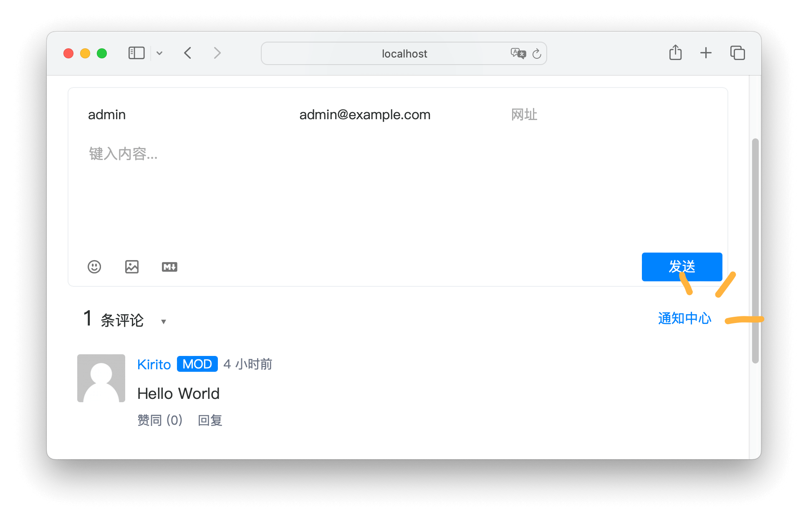

# Artalk

Artalk is a self-hosted comment system for blogs and websites: a 40 KB embeddable widget, an admin moderation sidebar, multi-site support, spam protection, and notifications — your comments live on infrastructure you control, not a third-party service. This repo is a one-click Railway wrapper around the official image (artalk/artalk-go v2.10.1, MIT), with the admin account auto-seeded and data persisted on a volume.

[](https://railway.com/deploy/artalk-1?utm_campaign=artalk)



Screenshot: upstream Artalk docs — the comment editor with a posted comment and moderation actions (ArtalkJS/Artalk, `docs/docs/images/sidebar/1.png`). The deployed default locale is English.

## Source Repository

[https://github.com/INAPP-Mobile/artalk](https://github.com/INAPP-Mobile/artalk)

## Deploy and Host

Click **Deploy on Railway** above. The deploy form has one generated field — an admin password — and nothing else to fill in. On first boot the entrypoint generates the config, creates the default site ("Artalk Blog"), and seeds the admin account (`admin` / `admin@example.com` + your generated password) from environment variables. Log in at your Railway domain and embed the widget on your blog with three lines of JavaScript:

```js
Artalk.init({
  el: '#Comments',
  pageKey: '/my-first-post.html',
  site: 'Artalk Blog',
  server: 'https://{your-railway-domain}',
})
```

## Why Deploy

- **Zero-field-ish deploy:** one generated secret, no setup wizard, no email step. The admin account and default site are seeded automatically on first boot.
- **Real comments, not a demo:** Markdown rendering, replies, votes, image upload, emoji, moderation queue, multi-site management, and social login — the same system that powers the Artalk docs site.
- **Always-on by design:** a single Go binary with an embedded SQLite database — it boots in about a second and sips memory.
- **Persistent:** the config, SQLite database, and uploads live on a Railway volume (`/data`) and survive redeploys.
- **Pinned upstream:** the official `artalk/artalk-go:2.10.1` image, pinned by digest — no `:latest` drift.
- **Actually works on Railway:** the stock image hardcodes `--port 23366`, which Railway never routes to — the other Artalk template on the marketplace sits at 0% health for exactly that reason. This wrapper maps Railway's injected `PORT` onto the server via `ATK_PORT` on every boot (the `--port` CLI flag is a dead flag in Artalk v2 — it is registered but never read — so `ATK_PORT` is the only mechanism that moves the listen port).

## Common Use Cases

- Add comments to a static blog (Hexo, Hugo, Jekyll, Ghost) without a third-party comment service.
- Run comments for several sites from one dashboard, with separate moderation queues per site.
- Replace Disqus/Commento with a self-hosted system where comment data stays yours.
- Moderate from the admin sidebar: approve, pin, edit, or delete comments without leaving the page.

## Configuration

| Variable | Default | What it does |
|---|---|---|
| `ATK_ADMIN_USERS_0_PASSWORD` | `${{secret(16)}}` (generated) | Password for the auto-seeded admin account (`admin` / `admin@example.com`). Set once on first boot; changing it later does not reset the admin password. |
| `ATK_ADMIN_USERS_0_NAME` | `admin` (baked) | Admin username. |
| `ATK_ADMIN_USERS_0_EMAIL` | `admin@example.com` (baked) | Admin email. Change it in the admin sidebar after deploy if you want notifications. |
| `ATK_LOCALE` | `en` (baked) | UI language (`en`, `zh-CN`, `zh-TW`, `ja`, `fr`, `ko`, `ru`, `tr`, `pt-PT`). |
| `ATK_TIMEZONE` | `UTC` (baked) | Application timezone (IANA name). |
| `ATK_SITE_DEFAULT` | `Artalk Blog` (baked) | Name of the default site, created on first boot. |
| `ATK_SITE_URL` | Derived at boot from `RAILWAY_PUBLIC_DOMAIN` | URL of the default site. This is a placeholder — replace it with your real blog URL in the admin sidebar (Site Management), and add each blog origin there so the embedded widget passes the CORS origin check. |
| `PORT` | Railway-injected | Mapped onto the server via `ATK_PORT` by the entrypoint on every boot (the `--port` CLI flag is dead in Artalk v2). Do not set it yourself. |

Other Artalk settings use their upstream defaults and can be overridden with `ATK_*` environment variables (see the [upstream environment variable reference](https://artalk.js.org/en/guide/env)). The most useful ones:

| Variable | Default | What it does |
|---|---|---|
| `ATK_AUTH_ANONYMOUS` | `false` | Allow commenting with just a nickname and email, no login. (Social login is off by default, so anonymous commenting already works out of the box.) |
| `ATK_MODERATOR_PENDING_DEFAULT` | `false` | Hold new comments for admin approval when `true`. |
| `ATK_CAPTCHA_ENABLED` | `false` | Enable captcha (`image`, `turnstile`, `recaptcha`, `hcaptcha` via `ATK_CAPTCHA_TYPE`). |
| `ATK_ADMIN_NOTIFY_EMAIL_ENABLED` | `true` | Email the admin on new comments (needs `ATK_ADMIN_NOTIFY_EMAIL_*` SMTP settings). |
| `ATK_DB_TYPE` | `sqlite` | `sqlite` (default, `./data/artalk.db`), `mysql`, `pgsql`, or `mssql`. |
| `ATK_TRUSTED_DOMAINS` | (site URLs) | Extra allowed origins for the embedded widget, space-separated. |
| `ATK_APP_KEY` | Generated into `/data/artalk.yml` on first boot | JWT signing key. Do not set it yourself — the generated config holds a stable per-volume key. |

### Deployment Dependencies

- **Runtime:** single Go-binary service from the official image; boots in ~1s, runs in well under 256 MB.
- **Port:** 8080 by default, mapped from Railway's injected `PORT` via `ATK_PORT` on every boot (a template install sets no `PORT` variable, so the entrypoint defaults to Railway's default service port — listening on Artalk's own 23366 default fails the platform healthcheck; the `--port` CLI flag is dead in Artalk v2 and cannot move the listen port).
- **Persistence:** one Railway volume mounted at `/data` (config `artalk.yml`, SQLite database `artalk.db`, uploads).
- **Healthcheck:** `/api/v2/version` (unauthenticated, 200, reports the running version). Note the app root `/` is a 302 to the admin sidebar (`/sidebar/`), so it cannot be the platform probe.
- **Plan tier:** runs on Railway's Hobby plan; no companion services.
