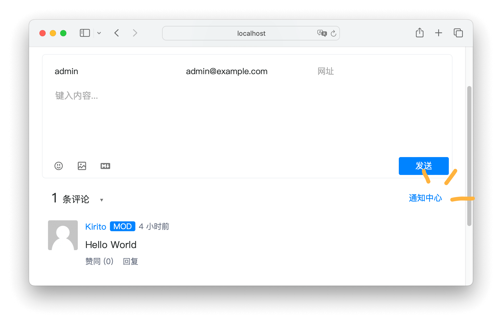

Screenshot: upstream Artalk docs — the comment editor with a posted comment and moderation actions (ArtalkJS/Artalk, `docs/docs/images/sidebar/1.png`). The deployed default locale is English.

# Deploy and Host

Artalk is a self-hosted comment system for blogs and websites: a 40 KB embeddable widget, an admin moderation sidebar, multi-site support, spam protection, and notifications — your comments live on infrastructure you control, not a third-party service. One click deploys the official image (artalk/artalk-go v2.10.1, MIT) as a single service with an embedded SQLite database. The deploy form has one generated field — an admin password — and nothing else to fill in. On first boot the admin account (`admin` / `admin@example.com` + your generated password) and the default site ("Artalk Blog") are created automatically; log in and embed the widget on your blog with three lines of JavaScript.

## About Hosting

Artalk runs as one Go-binary service from the official image, pinned by digest. The config, SQLite database, and uploads live on a Railway volume (`/data`) and survive redeploys. The binary boots in about a second and runs in well under 256 MB, so it fits easily on the Hobby plan with no companion services. Railway's injected `PORT` is mapped onto the server on every boot, and the healthcheck is the frontend (`/`, unauthenticated). The stock image hardcodes `--port 23366`, which Railway never routes to — the other Artalk template on the marketplace sits at 0% health for exactly that reason; this wrapper fixes it.

## Why Deploy

- **Zero-fuss start:** no setup wizard to click through, no email step — the admin account and default site are seeded on first boot.
- **Real comments:** Markdown rendering, replies, votes, image upload, emoji, moderation queue, multi-site management, and social login.
- **Always-on by design:** a single Go binary with an embedded SQLite database — it stays readable the moment you open it.
- **Private by default:** your comment data stays on your own volume; no third-party comment service sees it.

## Common Use Cases

- Add comments to a static blog (Hexo, Hugo, Jekyll, Ghost) without a third-party comment service.
- Run comments for several sites from one dashboard, with separate moderation queues per site.
- Replace Disqus/Commento with a self-hosted system where comment data stays yours.
- Moderate from the admin sidebar: approve, pin, edit, or delete comments without leaving the page.

## Dependencies for

### Deployment Dependencies

- **Runtime:** single Go-binary service; runs in well under 256 MB.
- **Port:** 23366 internally, mapped from Railway's injected `PORT` on every boot.
- **Persistence:** one Railway volume at `/data` (config, SQLite database, uploads).
- **Healthcheck:** `/` (frontend, unauthenticated).
- **Plan tier:** Hobby plan; no companion services.

**Environment variables (condensed reference):** `ATK_ADMIN_USERS_0_PASSWORD` (`${{secret(16)}}` — admin password, set once on first boot), `ATK_ADMIN_USERS_0_NAME` (`admin`, baked), `ATK_ADMIN_USERS_0_EMAIL` (`admin@example.com`, baked), `ATK_LOCALE` (`en`, baked), `ATK_TIMEZONE` (`UTC`, baked), `ATK_SITE_DEFAULT` (`Artalk Blog`, baked), `ATK_SITE_URL` (derived at boot from `RAILWAY_PUBLIC_DOMAIN` — replace with your real blog URL in the admin sidebar), `PORT` (injected by Railway and mapped automatically). Optional tunables: `ATK_AUTH_ANONYMOUS` (`false`), `ATK_MODERATOR_PENDING_DEFAULT` (`false`), `ATK_CAPTCHA_ENABLED` (`false`), `ATK_ADMIN_NOTIFY_EMAIL_ENABLED` (`true`), `ATK_DB_TYPE` (`sqlite`), `ATK_TRUSTED_DOMAINS` (extra allowed widget origins). See the [upstream environment variable reference](https://artalk.js.org/en/guide/env) for the full list.
